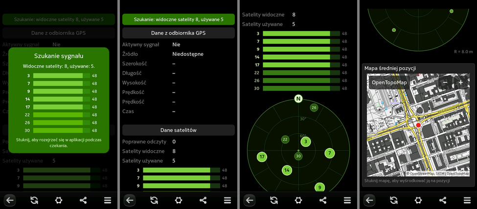

# GPS Info for Nokia N9

A GPS status application for the Nokia N9 (MeeGo Harmattan PR1.3).

* satellites in view and in use, with signal strength (SNR) bars
* sky plot of the satellites (azimuth/elevation), turned by the compass
* position, altitude, speed, time, time to first fix
* averages, horizontal/vertical accuracy, plot of the last 5 positions
* small map of the average position (OSM France, Esri Street, OpenTopoMap, CyclOSM)
  with a download counter; tiles are cached in `~/.cache/gpsinfo-n9/tiles`
* copy position (degrees, decimal, OpenStreetMap link) or open it in Maps
* the "searching" box never blocks the screen: tap it to look around while waiting
* languages: English, Polish, German, Spanish, Italian, French (follows the phone language)

The panel order follows the classic GPS MeeFo layout by DV8 Creations; all code and
graphics here are new.

## Install

Copy `dist/gpsinfo-n9_<version>_armel.deb` to the phone and install it as root:

    aegis-dpkg -i gpsinfo-n9_<version>_armel.deb

HTTPS map layers (OSM France, Esri) need the community TLS 1.2 update for the N9;
OpenTopoMap and CyclOSM work over plain HTTP.

## Notes for N9 developers

* On the phone, network requests made by QML `Image` elements (and even a
  `QNetworkAccessManager` in this C++ app) never finished: no data, no error.
  Map tiles are therefore downloaded with a plain `QSslSocket` HTTP/1.1 client
  (`TileJob` in `src/main.cpp`) and shown from files.
* Satellite data is not available to QML in QtMobility 1.2, so the small native
  launcher exposes `QGeoSatelliteInfoSource` as the `sats` context object.
* The package carries an Aegis manifest (`packaging/_aegis`) with the `Location` credential.
* Test switches: `GPSINFO_DEBUG=1` (log every tile), `GPSINFO_FAKE=1` (fake satellites),
  `GPSINFO_LANG=xx`, `GPSINFO_QML=/path/to/qml/`.

## Build

`build.sh` cross-compiles the launcher (`src/`, Qt 4.7 + QtMobility 1.2) with clang
against the Harmattan SDK headers and device libraries (moc is the Harmattan
`host-moc` run under qemu-arm); `packaging/make-deb.sh` builds the package.
The user interface is plain QML in `qml/`. `tools/i18n.py` generates `qml/i18n.js`,
`tools/radar.py` draws the sky plot backgrounds.

## Credits and license

Designed and written by Claude (Anthropic) together with smyhu for the Nokia N9.
Icon by smyhu.

MIT License, © 2026 smyhu. Maps © OpenStreetMap contributors, © Esri.
